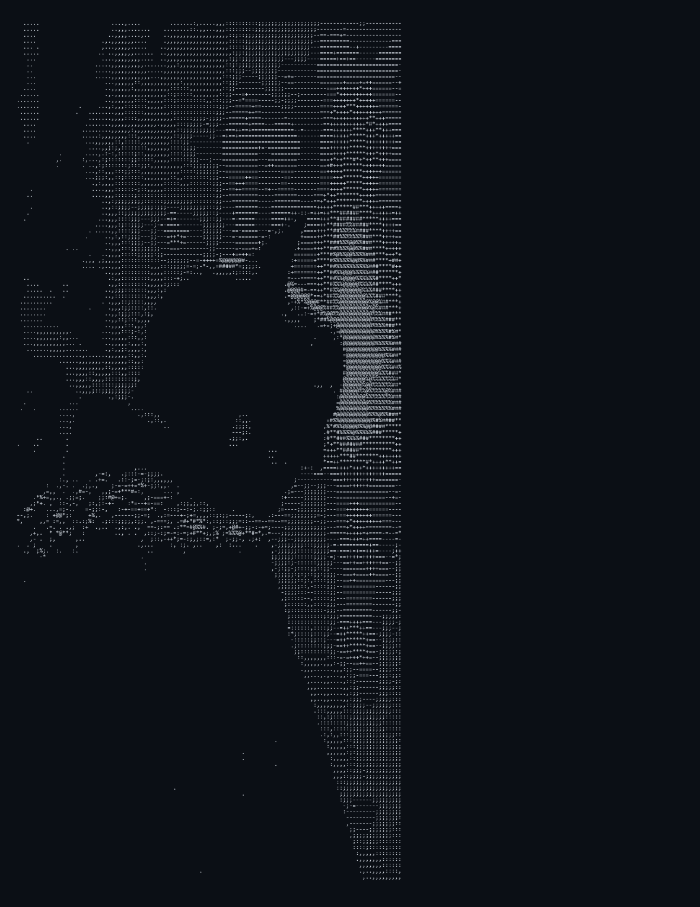

<a href="https://github.com/mohammedalhansharieff-gif">github.com/mohammedalhansharieff-gif</a>

🦇 Building in public since 2026

---

## 🦇 About Me

> Full-stack developer building practical web applications with a focus on clean interfaces, reliable backends, and useful automation. 
> I like simple systems, readable code, and products that feel sharp.

- Building projects with **JavaScript, TypeScript, React, Node.js and Python**
- Interested in **web development, APIs, databases and AI tools**
- Learning by building, testing, and improving real projects

## ⚙️ Tech Stack

## 🕶️ Projects

| Project | Description |
|---|---|
| [ALHAN](https://github.com/mohammedalhansharieff-gif/ALHAN) | Batman-themed developer profile and terminal-style artwork |
| [party-hall-booking](https://github.com/mohammedalhansharieff-gif/party-hall-booking) | Party hall booking application |

## 📊 GitHub Stats

&nbsp;&nbsp;

  

  

<b>THE NIGHT IS DARKEST BEFORE THE DAWN.</b>

